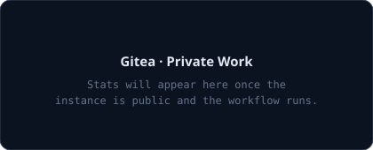

<h1 align="center">Aagam Sheth</h1>

---

<h2 align="center">Technical Skills</h2>

Languages 

ML · Deep Learning · Computer Vision 

Backend · Web 

Databases · Messaging 

Infrastructure · DevOps 

Tools · Platforms 

---

<h2 align="center">GitHub Statistics</h2>

---

<h2 align="center">Contribution Graph</h2>

<!--
<h2 align="center">Combined Activity · GitHub + Gitea</h2>

<h2 align="center">Gitea · Private Work</h2>

-->
